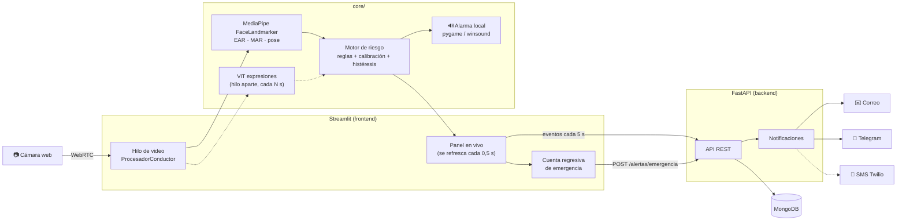
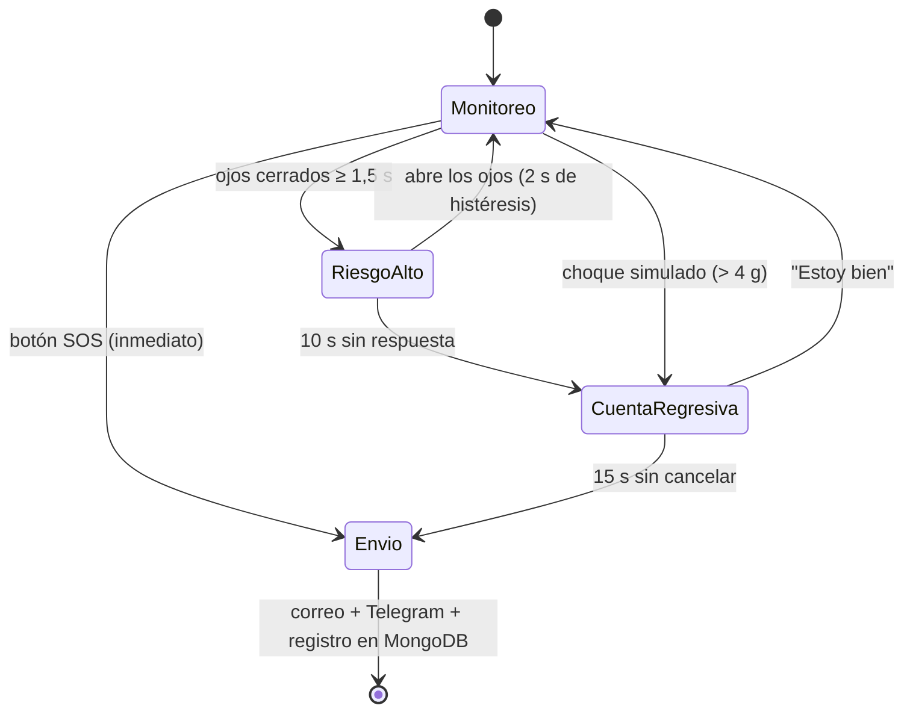

# 🚗 DriveGuard Lab

### Detección de somnolencia y riesgo del conductor con visión por computador


**Curso:** Deep Learning y Agentes Inteligentes
**Docente:** Ing. Julián René Muñoz Burbano
**Versión:** 1.0 (continuación de SentimentLab V3)

DriveGuard Lab observa al conductor con una cámara web y estima en tiempo real si está en riesgo por
**microsueño**, **cansancio**, **distracción** o **expresión negativa sostenida**. Cuando detecta riesgo,
**hace sonar una alarma** en el equipo y muestra un semáforo en pantalla. Si el conductor no responde, si
alguien pulsa **SOS** o si se simula un **impacto**, se activa un **protocolo de emergencia** que avisa a
los contactos por **correo electrónico** y **Telegram** (SMS opcional).

> [!WARNING]
> **Prototipo académico.** No sustituye sistemas de seguridad vehicular certificados. No lo use mientras
> conduce en vía pública: las pruebas se hacen con el vehículo detenido, frente al computador o con videos
> grabados. Las expresiones faciales son apariencias, no emociones reales.

---

## Tabla de contenido

1. [Qué detecta](#1-qué-detecta)
2. [Novedades respecto a SentimentLab V3](#2-novedades-respecto-a-sentimentlab-v3)
3. [Arquitectura](#3-arquitectura)
4. [Estructura del proyecto](#4-estructura-del-proyecto)
5. [Requisitos](#5-requisitos)
6. [Instalación en Windows con Anaconda](#6-instalación-en-windows-con-anaconda)
7. [Configuración de notificaciones](#7-configuración-de-notificaciones)
8. [Ejecución](#8-ejecución)
9. [Uso de la aplicación](#9-uso-de-la-aplicación)
10. [Protocolo de emergencia](#10-protocolo-de-emergencia)
11. [Laboratorios en Jupyter](#11-laboratorios-en-jupyter)
12. [API REST](#12-api-rest)
13. [Modelo de datos en MongoDB](#13-modelo-de-datos-en-mongodb)
14. [Parámetros configurables](#14-parámetros-configurables)
15. [Pruebas automáticas](#15-pruebas-automáticas)
16. [Rendimiento](#16-rendimiento)
17. [Solución de problemas](#17-solución-de-problemas)
18. [Limitaciones y ética](#18-limitaciones-y-ética)
19. [Referencias](#19-referencias)

---

## 1. Qué detecta

| Situación | Cómo se mide | Regla por defecto | Nivel |
|---|---|---|---|
| **Microsueño** | EAR (apertura de los ojos) | ojos cerrados de forma continua ≥ 1,5 s | 🔴 ALTO |
| **Cabeza caída** | inclinación de la cabeza (pitch) | > 15° durante ≥ 3 s | 🔴 ALTO |
| **Cansancio** | PERCLOS (porcentaje de ojos cerrados) | > 30 % del último minuto | 🟠 MEDIO |
| **Bostezos** | MAR (apertura de la boca) | ≥ 3 bostezos de ≥ 2 s en 5 min | 🟠 MEDIO |
| **Cabeceos** | inclinación de la cabeza | ≥ 3 en 60 s | 🟠 MEDIO |
| **Distracción** | giro de la cabeza (yaw) o rostro ausente | > 30° o sin rostro durante > 3 s | 🟠 MEDIO |
| **Expresión negativa aparente** | ViT de expresiones faciales | > 70 % de las clasificaciones en 30 s | 🟡 BAJO |
| **Conductor que no responde** | nivel ALTO sostenido | 10 s más con ojos cerrados, cabeza caída o sin rostro | 🚨 EMERGENCIA |

Todos los umbrales se cambian en la pestaña **Configuración**. Además, al iniciar la cámara el sistema se
**calibra** durante 10 s y fija el umbral de ojo cerrado en el 75 % del EAR propio de cada conductor.

---

## 2. Novedades respecto a SentimentLab V3

DriveGuard Lab mantiene la arquitectura de SentimentLab V3 (`core/`, `backend/` FastAPI, `frontend/`
Streamlit, MongoDB, `notebooks/`, `tests/`) y reutiliza su modelo de expresiones. Incorpora cinco ajustes
necesarios para que la aplicación funcione de verdad:

| # | Problema en V3 | Solución en DriveGuard Lab |
|---|---|---|
| 1 | **Ojos y bostezos.** El Haar Cascade solo encuentra la cara, no los ojos ni la boca. | **MediaPipe FaceLandmarker** (modelo preentrenado, funciona en CPU) entrega 478 puntos del rostro, con los que se calculan EAR, MAR y la orientación de la cabeza. Se usa la API *Tasks*, no la API antigua `mp.solutions`. |
| 2 | **La alarma.** En la cámara en vivo cada fotograma se procesa en un hilo aparte, y desde ahí Streamlit no puede reproducir sonido. | El sonido sale **localmente** en el portátil con **pygame** (o **winsound** en Windows) desde un hilo propio (`core/alarma.py`). La página solo muestra el aviso visual. |
| 3 | **El "siniestro".** Una cámara que mira al conductor no puede detectar un choque. | **Protocolo de emergencia** con tres disparadores: *conductor que no responde*, botón **SOS** y **choque simulado** con datos de acelerómetro (CSV). |
| 4 | **Ruta de datos del notebook.** El laboratorio 02 guardaba la captura en `data/captura_prueba.jpg`, pero la carpeta no venía en el zip y la celda fallaba. | `core/config.py` **crea automáticamente** `data/`, `data/capturas`, `data/videos`, `data/ejemplos`, `data/ojos`, `models/` y `assets/` al importarse. |
| 5 | **ViT lento en CPU.** El clasificador de expresiones frenaba el video. | El ViT corre en **un hilo aparte** y como máximo una vez cada `EXPRESION_INTERVALO_S` s (2 s por defecto). Si en clase va lento, suba el intervalo o desactívelo: **la detección de somnolencia no se ve afectada**. |

> [!TIP]
> **Corrección para SentimentLab V3:** si siguen usando el laboratorio 02, creen la carpeta antes de ejecutar
> la celda de cámara: `mkdir data` (desde la raíz de SentimentLab V3).

---

## 3. Arquitectura



**Por qué hay hilos separados:** `streamlit-webrtc` procesa cada fotograma en un hilo propio. Ese hilo ejecuta
MediaPipe, el motor de riesgo y la alarma (todo rápido, en CPU). El hilo de Streamlit no toca el video: lee el
estado cada 0,5 s con `@st.fragment(run_every=0.5)`, dibuja el semáforo, envía los eventos a la API y maneja la
cuenta regresiva. El ViT de expresiones corre en un tercer hilo para no bajar los FPS.

**Tolerancia a fallos:** si MongoDB no está disponible, la cámara y la alarma siguen funcionando. Si la API no
responde durante una emergencia, la interfaz envía la alerta directamente desde el equipo (respaldo local).

---

## 4. Estructura del proyecto

```
DriveGuardLab/
├── core/                         # Lógica (sin interfaz): se usa en la app, la API y los notebooks
│   ├── config.py                 # Rutas, .env, umbrales (ConfigRiesgo); crea data/ y models/
│   ├── landmarks.py              # MediaPipe FaceLandmarker: EAR, MAR, pose de la cabeza
│   ├── riesgo.py                 # Motor de riesgo: calibración, reglas, histéresis, emergencia
│   ├── pipeline.py               # Pipeline por fotograma + dibujo + análisis de videos
│   ├── alarma.py                 # Alarma local en hilo propio (pygame / winsound)
│   ├── faces.py                  # Haar + ViT de V3 y AnalizadorExpresiones en hilo aparte
│   ├── ojos_cnn.py               # CNN opcional de ojos abiertos/cerrados
│   ├── notificaciones.py         # Correo (SMTP), Telegram y SMS (Twilio)
│   ├── impacto.py                # Simulación de impacto con acelerómetro
│   ├── simulacion.py             # Datos sintéticos para pruebas y notebooks
│   └── storage.py                # MongoDB: conductores, sesiones, eventos, alertas
├── backend/                      # API REST (FastAPI)
│   ├── main.py                   # App, /health y registro de routers
│   ├── conductores_api.py        # CRUD de conductores y contactos
│   ├── sesiones_api.py           # Sesiones, eventos y estadísticas
│   ├── alertas_api.py            # Protocolo de emergencia y pruebas de envío
│   ├── schemas.py · utils.py
├── frontend/                     # Interfaz (Streamlit)
│   ├── app.py                    # Página principal, barra lateral y pestañas
│   ├── monitoreo_ui.py           # Cámara en vivo, semáforo, SOS, simulación de impacto
│   ├── conductor_ui.py · video_ui.py · historial_ui.py · config_ui.py
│   ├── estado.py · api_client.py · graficos.py
├── notebooks/
│   ├── 00_Verificacion_Entorno.ipynb
│   ├── 03_Somnolencia_EAR_MAR.ipynb
│   └── 04_CNN_Ojos_Abiertos_Cerrados.ipynb
├── scripts/
│   ├── descargar_modelos.py      # FaceLandmarker (+ ViT con --vit)
│   ├── generar_recursos.py       # Sonidos y CSV de ejemplo
│   └── datos_demo.py             # Sesiones de demostración en MongoDB
├── tests/                        # 43 pruebas con pytest (sin cámara ni MongoDB real)
├── docs/                         # Guía de laboratorio (LaTeX y PDF)
├── assets/                       # alarma_media.wav · alarma_alta.wav
├── data/                         # capturas/ · videos/ · ejemplos/ · ojos/
├── models/                       # face_landmarker.task · cnn_ojos.pt (opcional)
├── .env.example · requirements.txt · environment.yml · pytest.ini
└── README.md
```

---

## 5. Requisitos

| Componente | Mínimo | Recomendado |
|---|---|---|
| Sistema operativo | Windows 10/11, macOS o Linux | Windows 11 |
| Python | 3.11 (Anaconda o Miniconda) | 3.11 |
| Procesador | 4 núcleos | 8 núcleos |
| Memoria RAM | 8 GB | 16 GB |
| Cámara | webcam 720p | webcam 1080p con buena iluminación frontal |
| Base de datos | MongoDB Community Server 6+ o MongoDB Atlas | MongoDB local + Compass |
| Navegador | Chrome o Edge actualizados | Chrome |
| Internet | Solo la primera vez (modelos) y para enviar alertas | — |

No se necesita GPU. La aplicación se ejecuta en `localhost`; el navegador permite la cámara sin HTTPS en ese caso.

---

## 6. Instalación en Windows con Anaconda

Abra **Anaconda Prompt** y ubíquese en la carpeta del proyecto.

**Paso 1. Crear el entorno**

```bat
conda create -n DriveGuardLab python=3.11 -y
conda activate DriveGuardLab
python -m pip install --upgrade pip
python -m pip install -r requirements.txt
```

<details>
<summary>Alternativa con <code>environment.yml</code></summary>

```bat
conda env create -f environment.yml
conda activate DriveGuardLab
```
</details>

**Paso 2. Registrar el kernel de Jupyter**

```bat
python -m ipykernel install --user --name DriveGuardLab --display-name "Python (DriveGuard Lab)"
```

**Paso 3. Archivo de configuración**

```bat
copy .env.example .env
```

Para practicar sin credenciales de correo o Telegram, ponga `NOTIFICACIONES_SIMULADAS=true` en `.env`.

**Paso 4. Modelos y recursos**

```bat
python scripts/descargar_modelos.py
python scripts/generar_recursos.py
```

`descargar_modelos.py` guarda `models/face_landmarker.task` (≈ 3,6 MB). Para descargar con anticipación el ViT de
expresiones (≈ 350 MB) y evitar la espera en clase: `python scripts/descargar_modelos.py --vit`.

**Paso 5. MongoDB**

Instale **MongoDB Community Server** (marque *Install as a Service*) y, opcionalmente, **MongoDB Compass**.
Para usar Atlas, reemplace `MONGO_URI` en `.env` por su cadena `mongodb+srv://...`.

**Paso 6. Verificar**

```bat
python -m pytest
jupyter lab notebooks/00_Verificacion_Entorno.ipynb
```

> [!NOTE]
> No instale `opencv-python-headless` en este entorno: MediaPipe usa `opencv-contrib-python` y tener ambos
> paquetes causa conflictos con `cv2`.

---

## 7. Configuración de notificaciones

### Correo con Gmail

1. Active la **verificación en dos pasos** en la cuenta de Google que enviará las alertas.
2. Vaya a *Cuenta de Google → Seguridad → Contraseñas de aplicaciones* y cree una para "DriveGuard".
3. Copie la clave de 16 caracteres en `.env`:

```ini
SMTP_USER=cuenta.alertas@gmail.com
SMTP_PASSWORD=abcd efgh ijkl mnop
```

### Telegram (recomendado como "mensaje de texto", gratuito)

1. En Telegram, abra **@BotFather**, envíe `/newbot` y siga las instrucciones.
2. Copie el token en `.env` → `TELEGRAM_BOT_TOKEN=123456:ABC...`
3. Cada contacto de emergencia abre el bot y le envía cualquier mensaje.
4. En la app: **Configuración → ¿Cómo obtengo el chat_id? → Buscar chat_id**.
5. Copie el `chat_id` en la ficha del contacto (pestaña **Conductor**).

### SMS con Twilio (opcional)

Complete `TWILIO_ACCOUNT_SID`, `TWILIO_AUTH_TOKEN` y `TWILIO_FROM`, y registre el teléfono del contacto en
formato internacional (`+57...`). La cuenta de prueba de Twilio **solo envía a números verificados**.

Compruebe la configuración con **Configuración → Enviar mensaje de prueba**.

---

## 8. Ejecución

Se necesitan **dos consolas** con el entorno activado, ambas en la raíz del proyecto.

**Consola 1: API**

```bat
conda activate DriveGuardLab
python -m uvicorn backend.main:app --reload --port 8000
```

Documentación interactiva: <http://127.0.0.1:8000/docs>

**Consola 2: interfaz**

```bat
conda activate DriveGuardLab
python -m streamlit run frontend/app.py
```

Abra <http://localhost:8501> y permita el acceso a la cámara.

**Datos de demostración (opcional):** para que el historial tenga sesiones desde la primera clase:

```bat
python scripts/datos_demo.py
```

---

## 9. Uso de la aplicación

| Pestaña | Para qué sirve |
|---|---|
| 👤 **Conductor** | Registrar al conductor y sus contactos de emergencia (correo, Telegram chat_id, teléfono). |
| 🎯 **Ojos y calibración** | Ajustar el cierre en modo automático (EAR base × factor) o manual (umbral EAR fijo), simular aperturas y editar los seis puntos educativos. Use **Aplicar a la detección** para activar los cambios durante la sesión de interfaz. |
| 🎥 **Monitoreo en vivo** | Iniciar la cámara (**START**), ver el semáforo de riesgo y las métricas (EAR, PERCLOS, FPS, bostezos, cabeceos), pulsar **Estoy bien**, **Recalibrar** o **SOS**, y simular un impacto. |
| 🎬 **Video de prueba** | Analizar un video grabado con el mismo motor, ver gráficas, descargar métricas y el video anotado, y guardar el resultado en MongoDB. |
| 📊 **Historial** | Revisar sesiones: duración, eventos por tipo, EAR y PERCLOS en el tiempo, alertas enviadas y exportación a CSV. |
| ⚙️ **Configuración** | Ajustar umbrales, sonido, volumen y expresiones; probar la alarma y el envío de mensajes; buscar el chat_id de Telegram. |

En la barra lateral se elige el **conductor activo** y la **ubicación** (descripción y coordenadas) que se
incluye en el mensaje de emergencia.

**Recomendaciones para una buena detección:** luz frontal (no a contraluz), cámara a la altura de los ojos,
rostro completo en el encuadre y, durante la calibración, mirar al frente con los ojos abiertos.

---

## 10. Protocolo de emergencia



| Disparador | Condición | Cuenta regresiva |
|---|---|---|
| Conductor que no responde | nivel ALTO y 10 s más con ojos cerrados, cabeza caída o sin rostro | 15 s |
| Choque simulado | botón *Simular choque* o CSV de acelerómetro con pico > 4 g | 15 s |
| SOS | botón SOS | inmediato |

El mensaje incluye nombre del conductor, fecha y hora, tipo de evento, nivel de riesgo, ubicación (con enlace a
Google Maps si hay coordenadas) y la leyenda "alerta automática de un prototipo académico". Para no saturar a
los contactos, no se reenvía otra alerta de la misma sesión antes de `ALERTA_COOLDOWN_S` (120 s).

---

## 11. Laboratorios en Jupyter

Abra Jupyter con `jupyter lab` desde la raíz del proyecto y seleccione el kernel **Python (DriveGuard Lab)**.
La numeración continúa la de SentimentLab (01 y 02).

| Notebook | Contenido | Duración |
|---|---|---|
| `00_Verificacion_Entorno.ipynb` | Librerías, carpetas, modelo, sonidos, MongoDB y cámara | 20 min |
| `03_Somnolencia_EAR_MAR.ipynb` | EAR, MAR y PERCLOS; motor de riesgo con datos sintéticos; experimento de umbrales (detección vs. falsas alarmas); puntos faciales en foto y video; ViT; alarma; mensajes; impacto | 2 sesiones |
| `04_CNN_Ojos_Abiertos_Cerrados.ipynb` | Entrenamiento de una CNN real (MRL Eye Dataset o capturas propias), matriz de confusión, F1, comparación EAR vs. CNN y uso en la app (`OJOS_METODO=cnn`) | 2 sesiones |

Las celdas que usan cámara, sonido, el ViT o el envío real de mensajes están **desactivadas por defecto**
(`USE_CAMERA = False`, `SONAR = False`, `USE_VIT = False`, `ENVIAR = False`), de modo que todos los notebooks
se ejecutan de principio a fin en cualquier equipo.

La guía completa para estudiantes está en [`docs/Guia_Laboratorio_DriveGuard.pdf`](docs/Guia_Laboratorio_DriveGuard.pdf).

---

## 12. API REST

| Método | Ruta | Descripción |
|---|---|---|
| GET | `/health` | Estado de la API, MongoDB y canales de notificación |
| POST · GET | `/conductores` | Crear y listar conductores |
| GET · PUT · DELETE | `/conductores/{id}` | Consultar, actualizar o eliminar un conductor |
| POST · GET | `/sesiones` | Crear y listar sesiones (filtro `conductor_id`) |
| GET | `/sesiones/{id}` | Detalle de una sesión |
| PUT | `/sesiones/{id}/cerrar` | Cerrar una sesión y calcular su resumen |
| POST | `/eventos/lote` | Guardar eventos en lote (la interfaz los envía cada 5 s) |
| GET | `/eventos?sesion_id=` | Eventos de una sesión |
| GET | `/estadisticas/{sesion_id}` | Resumen: eventos por tipo y nivel, EAR promedio, PERCLOS máximo |
| POST | `/alertas/emergencia` | Ejecutar el protocolo de emergencia |
| POST | `/alertas/prueba` | Enviar un mensaje de prueba (real o simulado) |
| GET | `/alertas` | Historial de alertas |
| GET | `/alertas/canales` | Canales configurados |
| GET | `/alertas/telegram/chats` | chat_id de quienes escribieron al bot |

Ejemplo:

```bash
curl -X POST http://127.0.0.1:8000/alertas/emergencia \
     -H "Content-Type: application/json" \
     -d '{"conductor_id": "<id>", "motivo": "sos", "ubicacion": {"descripcion": "Vía Pasto - Ipiales"}}'
```

---

## 13. Modelo de datos en MongoDB

Base: `driveguard_lab` (configurable con `MONGO_DB`).

| Colección | Campos principales |
|---|---|
| `conductores` | `nombre`, `documento`, `contactos[{nombre, correo, telegram_chat_id, telefono}]`, `creado` |
| `sesiones` | `conductor_id`, `inicio`, `fin`, `ubicacion`, `config`, `origen` (camara/video/demo), `resumen` |
| `eventos` | `sesion_id`, `fecha`, `tipo` (microsueno, cansancio_perclos, bostezos, ..., `muestra`), `nivel`, `ear`, `ear_umbral`, `mar`, `perclos`, `bostezos`, `cabeceos`, `expresion` |
| `alertas` | `sesion_id`, `conductor_id`, `motivo`, `estado` (enviada/fallida/omitida_cooldown), `resultados[]`, `fecha` |

**No se guardan imágenes ni fotogramas**, solo métricas numéricas. Los eventos de tipo `muestra` (cada 5 s)
permiten graficar el EAR y el PERCLOS de cada sesión.

---

## 14. Parámetros configurables

**Variables de entorno (`.env`)**

| Variable | Defecto | Descripción |
|---|---|---|
| `MONGO_URI` / `MONGO_DB` | `mongodb://localhost:27017` / `driveguard_lab` | Conexión a MongoDB |
| `API_URL` | `http://127.0.0.1:8000` | Dirección de la API para la interfaz |
| `EXPRESIONES_ACTIVAS` | `true` | Activa el ViT de expresiones |
| `EXPRESION_INTERVALO_S` | `2.0` | Segundos entre clasificaciones del ViT |
| `OJOS_METODO` | `ear` | `ear` o `cnn` (requiere el notebook 04) |
| `ALARMA_BACKEND` | `auto` | `auto`, `pygame`, `winsound` o `ninguno` |
| `NOTIFICACIONES_SIMULADAS` | `false` | `true` registra los envíos sin enviarlos |
| `ALERTA_COOLDOWN_S` | `120` | Espera mínima entre alertas de la misma sesión |

**Umbrales del motor (pestaña Configuración o `core/config.py → ConfigRiesgo`)**

| Parámetro | Defecto | Efecto |
|---|---|---|
| `calibracion_s` | 10 s | Duración de la calibración inicial |
| `factor_ear` | 0,75 | Umbral de ojo cerrado = factor × EAR base |
| `microsueno_s` | 1,5 s | Ojos cerrados continuos para nivel ALTO |
| `perclos_umbral` | 30 % | Cansancio por PERCLOS (ventana de 60 s) |
| `mar_umbral` / `bostezo_min_s` | 0,60 / 2 s | Definición de bostezo |
| `cabeceo_grados` / `giro_grados` | 15° / 30° | Cabeceo y distracción |
| `histeresis_s` | 2 s | Tiempo antes de bajar de nivel |
| `sin_respuesta_s` | 10 s | Tiempo en ALTO sin respuesta antes de la emergencia |

---

## 15. Pruebas automáticas

```bat
python -m pytest
```

Las 43 pruebas no requieren cámara, modelo ni MongoDB real (se usa `mongomock`):

| Archivo | Qué verifica |
|---|---|
| `test_metricas.py` | EAR y MAR con puntos conocidos, invarianza a escala, ángulos de la cabeza |
| `test_riesgo.py` | Calibración, microsueño, cansancio, cabeceos, distracción, histéresis, "Estoy bien" y emergencia |
| `test_pipeline.py` | Pipeline con detector simulado, eventos, alarma, dibujo y creación de `data/` |
| `test_notificaciones_impacto.py` | Mensajes, SMTP y Telegram simulados, modo simulado, detección de impacto |
| `test_api.py` | CRUD, sesiones, eventos, estadísticas, emergencia, cooldown y respaldo sin MongoDB |

---

## 16. Rendimiento

| Componente | Costo aproximado en CPU | Frecuencia |
|---|---|---|
| MediaPipe FaceLandmarker | 10–25 ms por fotograma | cada fotograma (15–30 FPS) |
| Motor de riesgo y dibujo | < 2 ms | cada fotograma |
| ViT de expresiones | 150–600 ms por imagen | cada 2 s, en un hilo aparte |
| CNN de ojos (opcional) | ≈ 3 ms por par de ojos | cada fotograma |

Si el video va lento: suba `EXPRESION_INTERVALO_S` (por ejemplo, a 4 s), desactive las expresiones en
**Configuración**, cierre otras aplicaciones que usen la cámara o baje la resolución de la cámara.

---

## 17. Solución de problemas

| Síntoma | Causa probable | Solución |
|---|---|---|
| "API no disponible" en la barra lateral | uvicorn no está en ejecución | Inicie la consola 1 desde la raíz del proyecto |
| "MongoDB no disponible" | servicio detenido o `MONGO_URI` incorrecto | Inicie el servicio *MongoDB Server* en `services.msc` o revise `.env` |
| "No se pudo iniciar el detector" | falta `models/face_landmarker.task` | `python scripts/descargar_modelos.py` |
| La cámara no inicia | permiso denegado u otra app usando la cámara | Permita la cámara en el navegador; cierre Teams, Zoom, etc. |
| No suena la alarma | pygame sin dispositivo de audio | Pruebe con `ALARMA_BACKEND=winsound`; revise el volumen de Windows |
| Muchas falsas alarmas de microsueño | iluminación pobre o calibración con ojos entrecerrados | **Recalibrar** con buena luz; baje `factor_ear` o suba `microsueno_s` |
| El correo falla con error de autenticación | contraseña normal en vez de contraseña de aplicación | Cree una contraseña de aplicación en Google |
| Telegram responde "chat not found" | el contacto no ha escrito al bot | El contacto debe abrir el bot y enviar un mensaje |
| `ImportError: cv2` o conflictos de OpenCV | conviven varias versiones de OpenCV | `pip uninstall opencv-python opencv-python-headless` y reinstale `opencv-contrib-python` |
| La celda de cámara del notebook falla | el kernel no corre en el equipo con la cámara | Ejecute Jupyter localmente o use el modo video |

---

## 18. Limitaciones y ética

- **No es un dispositivo de seguridad.** Es un prototipo para aprender visión por computador, sistemas
  multihilo y diseño de alertas. Su desempeño no ha sido validado en conducción real.
- **Iluminación y oclusiones:** las gafas oscuras, el contraluz, la noche sin luz infrarroja o la mano en la
  cara reducen la precisión. Los sistemas comerciales usan cámaras infrarrojas.
- **Expresiones ≠ emociones:** el ViT clasifica apariencias faciales y tiene sesgos de su conjunto de
  entrenamiento. No debe usarse para evaluar a personas.
- **Choques:** la detección de impacto es una simulación. Un vehículo real necesita un acelerómetro físico.
- **Privacidad:** se requiere consentimiento de quien aparece en la cámara. No se guardan imágenes, solo
  métricas. Los datos de contacto se guardan en MongoDB: proteja el acceso a la base de datos.
- **Alertas reales:** use cuentas y contactos de prueba. No envíe alertas falsas a servicios de emergencia.

---

## 19. Referencias

- Soukupová, T. y Čech, J. (2016). *Real-Time Eye Blink Detection using Facial Landmarks*. 21st Computer Vision
  Winter Workshop.
- Wierwille, W. W. y Ellsworth, L. A. (1994). Evaluation of driver drowsiness by trained raters. *Accident
  Analysis & Prevention*, 26(5), 571–581. (Origen de la métrica PERCLOS.)
- Fusek, R. (2018). Pupil localization using geodesic distance. *ISVC 2018*. (MRL Eye Dataset.)
- Google. *MediaPipe Face Landmarker*.
  <https://ai.google.dev/edge/mediapipe/solutions/vision/face_landmarker>
- Dosovitskiy, A. et al. (2021). *An Image is Worth 16x16 Words: Transformers for Image Recognition at Scale*. ICLR.
- Modelo de expresiones: `trpakov/vit-face-expression` (Hugging Face).

---

<sub>DriveGuard Lab · Curso Deep Learning y Agentes Inteligentes · Ing. Julián René Muñoz Burbano · 2026</sub>
